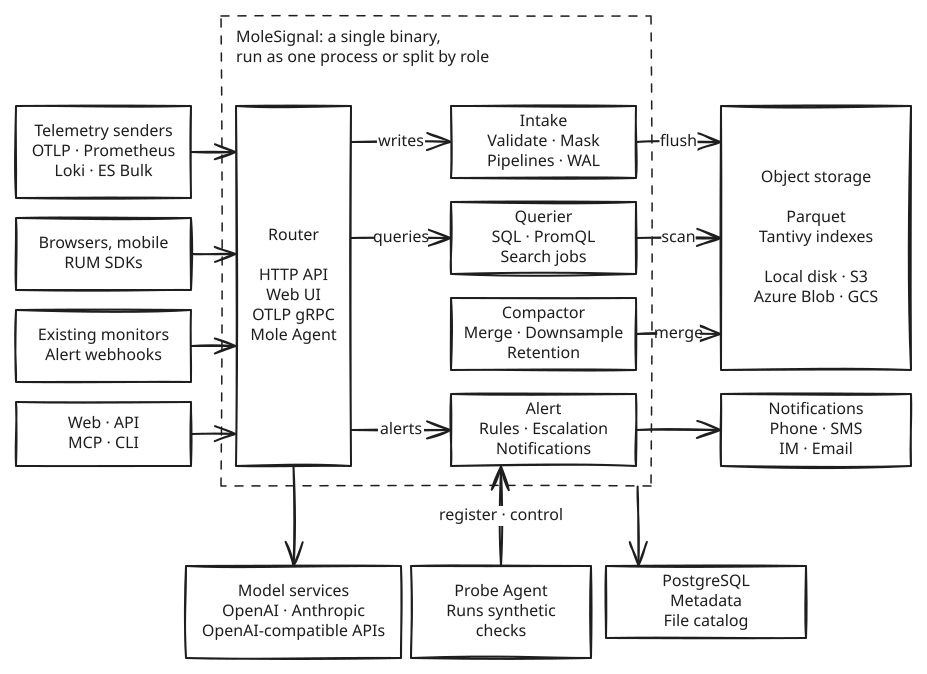

<p align="center">
  
</p>

<h1 align="center">MoleSignal</h1>

<p align="center">
  Open-source, fully self-hostable observability and incident response.<br>
  Telemetry, alerting, on-call, status pages and AI investigation live in one system. Your data, permissions and models stay in your environment.
</p>

<p align="center">
  <a href="https://github.com/molesignal/molesignal/releases"></a>
  <a href="LICENSE"></a>
</p>

<p align="center">
  <a href="#quick-start">Quick start</a> ·
  <a href="#features">Features</a> ·
  <a href="#architecture">Architecture</a> ·
  <a href="https://docs.molesignal.com/en-US">Docs</a> ·
  <a href="https://molesignal.com">Website</a> ·
  <a href="https://discord.gg/JXG98xA6FH">Discord</a> ·
  <a href="README.zh-CN.md">简体中文</a>
</p>

## Why MoleSignal

- **Connected signals**: Logs, metrics and traces share one storage layer and one query engine. Drill from a metric to a trace to a log and the time range and filters come with you. One SQL query can JOIN across streams.
- **Observability and incident response in one product**: Alerts flow straight into on-call and notifications, an incident links to its metrics, traces and logs, and status pages and postmortems carry on from the incident.
- **AI that works in your environment**: Mole Agent uses the platform's own data and permissions. You choose the model, which can run on your internal network. High-risk operations wait for a person to approve them.
- **Existing protocols**: Point your OpenTelemetry SDKs, Collector, Prometheus or Fluent Bit at it. No proprietary collector is needed.
- **Simple to run, easy to scale**: One Rust binary that needs only PostgreSQL and somewhere to keep data (local disk or object storage). Start with one process and split by role when you need to scale.
- **Governance built in**: Organization isolation, single sign-on, two-factor sign-in, fine-grained permissions, audit logs and field masking are all included.

## Who it's for

- Your data can't leave your environment, or your SaaS bill has become hard to justify.
- You have a few SREs or platform engineers, but no dedicated team to run a whole observability stack.
- You've pieced together Prometheus, Grafana, Loki, Alertmanager and an on-call tool, and want them in one place.

You don't have to replace your monitoring all at once. Start with alerts only, use on-call and status pages, and move telemetry later.

## Quick start

```bash
git clone https://github.com/molesignal/molesignal.git
cd molesignal
docker compose -f deploy/docker/docker-compose.yaml --profile standalone up -d
```

Open <http://localhost:5080> and sign in with `admin@example.com` and `admin`.

> These accounts and keys are sample values for local trials. Before going to production, read the [production checklist](https://docs.molesignal.com/en-US/deployment/production-checklist).

Then pick a path.

### Start with your existing alerts

1. In **Alerts → Sources**, create a source, choose the sender type and save the generated token. The page shows how to configure that type.
2. With the **API** type, you can send one right away:

   ```bash
   curl -X POST http://localhost:5080/api/v1/intake/alerts \
     -H 'Authorization: Bearer <source token>' \
     -H 'Content-Type: application/json' \
     -d '{"dedup_key": "disk-full/web-1", "summary": "Disk almost full on web-1", "severity": "critical", "labels": {"host.name": "web-1"}}'
   ```

   For Alertmanager, add a receiver and route alerts to it:

   ```yaml
   receivers:
     - name: molesignal
       webhook_configs:
         - url: http://<MoleSignal host>:5080/api/v1/intake/alerts
           send_resolved: true
           http_config:
             authorization:
               credentials: <source token>
   ```

3. Set up **On-call schedules** and **Escalations**, add a notification connector in **Settings**, then give this source an escalation policy (by default it follows routing). New incidents now reach whoever is on call.

Sender types also include Grafana, Datadog, PagerDuty, Alibaba Cloud CloudMonitor, Tencent Cloud Observability Platform, Amazon CloudWatch, Zabbix and email. See the [alert sources docs](https://docs.molesignal.com/en-US/alerting/sources).

Moving from Opsgenie or PagerDuty? You don't have to rebuild schedules by hand: in **On-call schedules**, import the JSON their APIs return, with a preview before anything is written. See the [schedule migration docs](https://docs.molesignal.com/en-US/alerting/schedule-migration).

### Send telemetry

In **account settings → API tokens**, create a token and write a log:

```bash
curl -X POST http://localhost:5080/api/v1/intake/logs/app \
  -H 'Authorization: Bearer <API Token>' \
  -H 'Content-Type: application/json' \
  -d '[{"level":"error","msg":"db pool exhausted","trace_id":"abc123"}]'
```

Query it with SQL:

```bash
curl -G http://localhost:5080/api/v1/query \
  -H 'Authorization: Bearer <API Token>' \
  --data-urlencode "language=sql" \
  --data-urlencode "statement=SELECT * FROM app WHERE trace_id = 'abc123'" \
  --data-urlencode "start=$(( ($(date +%s) - 3600) * 1000000 ))" \
  --data-urlencode "end=$(( ($(date +%s) + 60) * 1000000 ))" \
  --data-urlencode "stream=app" \
  --data-urlencode "stream_type=logs"
```

If you already run the OpenTelemetry Collector, add one exporter to send all three signals:

```yaml
exporters:
  otlphttp/molesignal:
    endpoint: http://<MoleSignal host>:5080/api
    headers:
      authorization: "Bearer <API Token>"

service:
  pipelines:
    traces:
      exporters: [otlphttp/molesignal]
    metrics:
      exporters: [otlphttp/molesignal]
    logs:
      exporters: [otlphttp/molesignal]
```

The **Datasource** page in the product has setup steps for more than 40 sources.

## Features

### Observability

- **[Logs](https://docs.molesignal.com/en-US/logs)**: full-text search, SQL, log patterns, async search jobs, scheduled inspections.
- **[Metrics](https://docs.molesignal.com/en-US/metrics)**: PromQL, downsampling, cardinality limits.
- **[Traces](https://docs.molesignal.com/en-US/traces) and [APM](https://docs.molesignal.com/en-US/apm)**: RED metrics and service maps derived from traces, error grouping, SLOs, version comparison.
- **[Profiles](https://docs.molesignal.com/en-US/profiles)**: continuous profiling, flame graphs, comparison.
- **[RUM](https://docs.molesignal.com/en-US/rum)**: session replay, error grouping with source maps, Web Vitals, frustration signals, funnels, paths, retention, heatmaps, feature flags.
- **[Synthetics](https://docs.molesignal.com/en-US/synthetics)**: HTTP (multi-step), TCP, SSH, DNS, ICMP, TLS, gRPC, browser and heartbeat checks, with Probe Agents you can deploy to any network location.
- **[Dashboards](https://docs.molesignal.com/en-US/dashboards) and [reports](https://docs.molesignal.com/en-US/reports)**: custom dashboards with variables, scheduled reports.
- **[Cross-signal investigation](https://docs.molesignal.com/en-US/correlation)**: an investigation stack keeps your drill-down path (`⌘[` and `⌘]` move through it), and the `⌘K` command palette jumps to any kind of resource.

### Alerting and incident response

- **[Alert rules](https://docs.molesignal.com/en-US/alerting/rules)**: scheduled, real-time, anomaly, forecast and composite rules in SQL or PromQL; no-data alerts; Prometheus rule import; automatic discovery of problems in APM, RUM, logs and resource metrics.
- **[Incidents](https://docs.molesignal.com/en-US/alerting/incidents)**: grouping, routing, silences, inhibition, priority and urgency.
- **[On-call](https://docs.molesignal.com/en-US/alerting/on-call)**: schedules, escalation policies, shift swaps, holiday calendars, calendar feeds.
- **[Notifications](https://docs.molesignal.com/en-US/notification-channels)**: phone and SMS (Alibaba Cloud, Tencent Cloud, Huawei Cloud, Twilio, AWS), Lark/Feishu, DingTalk, WeCom, Slack, Microsoft Teams, Google Chat, email and webhooks; templates, policies, quiet hours.
- **[Major incidents](https://docs.molesignal.com/en-US/alerting/major-incidents)**: roles and tasks, war rooms, status updates; [tickets](https://docs.molesignal.com/en-US/alerting/tickets) (Jira, ServiceNow, Meegle); meetings (Zoom, Google Meet, Tencent Meeting).
- **[Remediation](https://docs.molesignal.com/en-US/alerting/remediation)**: HTTP and Kubernetes actions that run after approval, then check whether the incident recovered.
- **[Status pages](https://docs.molesignal.com/en-US/status-pages)**: components, incident updates, planned maintenance, subscriptions, private access, custom domains with automatic certificates; rules can update them as incidents change.
- **Postmortems**: postmortem documents and action items, which can become tickets.

### Mole Agent

[Mole Agent](https://docs.molesignal.com/en-US/agent) is the built-in AI SRE.

- **Investigates incidents**: records hypotheses and evidence and writes a root cause analysis. Severe incidents, Cron schedules or an external API can trigger automations, and the conclusion goes back on the incident.
- **Your choice of model**: OpenAI, Anthropic and any OpenAI-compatible API. You can set a daily token budget.
- **Permissions and approvals**: more than 200 built-in tools all check the caller's permissions. Each tool has a default execution mode by risk level (automatic, confirm in chat, single approval, dual approval). An organization can tighten it, and high-risk tools can't be loosened.
- **Team knowledge**: knowledge, memory and skills are managed per organization, team or person. Skills can be installed from Git repositories, and external MCP servers add more tools.
- **Available where you work**: open the side panel on any page, or talk to it in [IM such as Lark/Feishu and Slack](https://docs.molesignal.com/en-US/im). Other AI clients connect through [MCP](https://docs.molesignal.com/en-US/inbound-mcp) or the [`@molesignal/cli`](https://github.com/molesignal/molesignal-cli) command-line tool.
- **Measurable quality**: rules and models score its answers, and prompt changes can be checked by replay first.

### Data and query

- **Storage**: data is stored as Parquet and indexed with Tantivy, and queries prune by file. PostgreSQL holds only metadata and the file catalog.
- **Query**: [full SQL](https://docs.molesignal.com/en-US/query) (JOINs, CTEs, window functions) and a [PromQL subset](docs/promql_subset.md). Large queries can run as async search jobs. DBeaver, JDBC and ADBC can connect over Arrow Flight SQL (off by default).
- **Across clusters**: one query can cover several registered clusters. Unreachable clusters are flagged without affecting the other results.
- **[Pipelines and functions](https://docs.molesignal.com/en-US/pipelines)**: process data at intake or on a schedule with VRL or JavaScript, or call a model. Fan-out, retries, dead letters and backfill are supported, and extend tables provide lookups.

### Security and governance

- **Sign-in**: single sign-on through OIDC, SAML, LDAP, GitHub and Lark/Feishu; two-factor sign-in with TOTP and passkeys; sign-in rate limits.
- **Access**: organization isolation, teams, roles and fine-grained permissions. Resources can be shared individually, and API Tokens can be limited in scope.
- **Data**: field masking and field encryption, audit logs, retention per stream. Connector and model secrets are stored encrypted and are never returned after being written.

See the [identity](https://docs.molesignal.com/en-US/identity) and [security](https://docs.molesignal.com/en-US/security) docs.

## Intake

| Protocol or source | Address | Notes |
|---|---|---|
| OTLP/HTTP | `/api/v1/logs`, `/api/v1/metrics`, `/api/v1/traces` | OpenTelemetry SDKs and Collector |
| OTLP gRPC | `:4317` | OpenTelemetry SDKs and Collector |
| Prometheus remote_write | `/api/v1/prometheus/api/v1/write` | Prometheus, VictoriaMetrics |
| Elasticsearch Bulk | `/api/v1/_bulk` | Shippers that write to the Bulk API |
| Loki push | `/api/v1/loki/api/v1/push` | JSON bodies only; the snappy protobuf that Promtail and Grafana Alloy send by default is not supported |
| Native JSON | `/api/v1/intake/{logs,metrics,traces}/<stream>` | curl or your application |
| Profiles | `/api/v1/profiles/otlp`, `/api/v1/profiles/intake` | OTLP and pprof |
| RUM | `/api/v1/rum/events` | [`@molesignal/browser-rum`](https://github.com/molesignal/browser-rum), [`molesignal_flutter`](https://github.com/molesignal/flutter-rum); examples for Android and iOS |
| Cloud push | `/api/v1/_kinesis_firehose`, `/api/v1/_cloudflare`, `/api/v1/_heroku` | Kinesis Firehose, Cloudflare Logpush, Heroku |
| Pull | Connector settings | Kafka, S3, CloudWatch Logs |
| External alerts | `/api/v1/intake/alerts` | See [Start with your existing alerts](#start-with-your-existing-alerts) |

See the [intake docs](https://docs.molesignal.com/en-US/intake) for more.

## Architecture

<picture>
  <source media="(prefers-color-scheme: dark)" srcset="assets/architecture/overview_en_dark.svg">
  
</picture>

Writes go to a WAL and an in-memory buffer, then flush to Parquet and indexes in object storage. Queries merge the flushed files with what is still in the buffer. The web UI is built into the binary, so there is no separate frontend to deploy.

By default one process runs every role. [Split by role](https://docs.molesignal.com/en-US/deployment/role-based) when you need to. See the [architecture docs](https://docs.molesignal.com/en-US/architecture) and, for the source layout, [ARCHITECTURE.md](ARCHITECTURE.md). The diagram's editable source is [`overview.en.excalidraw`](assets/architecture/overview.en.excalidraw).

## Deployment

| Method | Details |
|---|---|
| Docker Compose | See [Quick start](#quick-start); use `--profile multirole` to split by role |
| Helm | See the commands below, or use `oci://ghcr.io/molesignal/charts/molesignal` |
| Binary | Download from [Releases](https://github.com/molesignal/molesignal/releases) (Linux x86_64, aarch64), set `[meta_database]` in `conf/config.toml`, and run `bin/molesignal --config conf/config.toml`. A systemd unit is in [`deploy/systemd`](deploy/systemd) |
| Kubernetes manifests | [`deploy/k8s`](deploy/k8s) |

```bash
helm repo add molesignal https://charts.molesignal.com
helm repo update
helm install molesignal molesignal/molesignal --namespace molesignal --create-namespace
kubectl --namespace molesignal port-forward svc/molesignal 5080:5080
```

| Port | Purpose |
|---|---|
| 5080 | HTTP API and web UI |
| 4317 | OTLP gRPC (not mapped in the Compose standalone profile; add it if you need it) |
| 5082 | Internal cluster gRPC |
| 5083 | Arrow Flight SQL (off by default) |
| 5084, 5085 | Probe Agent registration and control |

Every node exposes Prometheus `/metrics`.

## Building from source

```bash
make build-release
./target/release/molesignal --config conf/config.toml
```

See the [contributing guide](CONTRIBUTING.md) for the development environment.

## Related repositories

| Repository | Contents |
|---|---|
| [docs](https://github.com/molesignal/docs) | Documentation site |
| [molesignal-helm](https://github.com/molesignal/molesignal-helm) | Helm chart |
| [molesignal-cli](https://github.com/molesignal/molesignal-cli) | Command-line tool |
| [browser-rum](https://github.com/molesignal/browser-rum) | Browser RUM SDK |
| [flutter-rum](https://github.com/molesignal/flutter-rum) | Flutter RUM SDK |

## Contributing

Issues and pull requests are welcome. Please read the [contributing guide](CONTRIBUTING.md) and the [code of conduct](CODE_OF_CONDUCT.md) first, and report security issues through the [security policy](SECURITY.md) rather than a public issue. Questions and chat: [Discord](https://discord.gg/JXG98xA6FH).

### Contributors

Thanks to everyone who has contributed to MoleSignal:

<a href="https://github.com/molesignal/molesignal/graphs/contributors">
  
</a>

## License

Copyright 2026 MoleSignal Authors. Released under the [Apache-2.0](LICENSE) license. Third-party notices are in [THIRD_PARTY_NOTICES.md](THIRD_PARTY_NOTICES.md).
