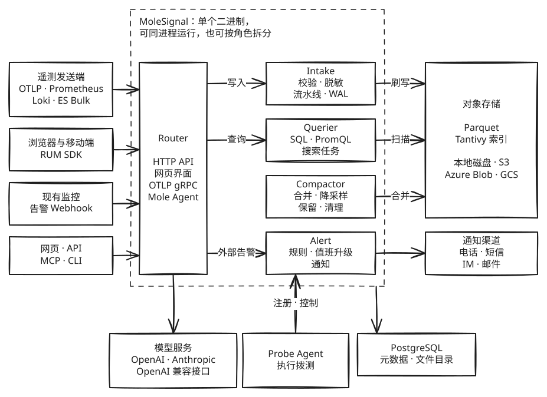

<p align="center">
  
</p>

<h1 align="center">MoleSignal</h1>

<p align="center">
  开源、可完全自托管的可观测性与事件响应平台。<br>
  遥测、告警、值班、状态页和 AI 调查都在一个系统里，数据、权限和模型留在你自己的环境。
</p>

<p align="center">
  <a href="https://github.com/molesignal/molesignal/releases"></a>
  <a href="LICENSE"></a>
</p>

<p align="center">
  <a href="#快速开始">快速开始</a> ·
  <a href="#功能">功能</a> ·
  <a href="#架构">架构</a> ·
  <a href="https://docs.molesignal.com/zh-Hans">文档</a> ·
  <a href="https://molesignal.com">官网</a> ·
  <a href="https://discord.gg/JXG98xA6FH">Discord</a> ·
  <a href="README.md">English</a>
</p>

## 为什么选 MoleSignal

- **信号连在一起**：日志、指标和链路写入同一层存储，用同一个查询引擎。从指标下钻到链路再到日志，时间范围和过滤条件会一路带上；一条 SQL 也能跨数据流 JOIN。
- **可观测性和事件响应在一个产品里**：告警直接进入值班和通知，事件页上能跳到相关的指标、链路和日志，状态页和复盘也从事件接着往下走。
- **AI 在你的环境里工作**：Mole Agent 直接使用平台里的数据和权限，模型由你选择，可以是内网模型。高风险操作必须等人批准。
- **用现成的协议接入**：OpenTelemetry SDK、Collector、Prometheus 和 Fluent Bit 改个地址就能发过来，不需要专有采集器。
- **架构简单，容易扩展**：一个 Rust 二进制，只依赖 PostgreSQL 和一个存数据的地方（本地磁盘或对象存储）。可以从单进程开始，需要时再按角色拆分和扩容。
- **治理能力内置**：多组织隔离、单点登录、两步验证、细粒度权限、审计和字段脱敏，都不用另外搭。

## 适合谁

- 数据不能离开自己的环境，或者 SaaS 账单已经难以承受。
- 有几位 SRE 或平台工程师，但没有专职团队维护一整套可观测性组件。
- 现在靠 Prometheus、Grafana、Loki、Alertmanager 加一个值班工具拼在一起，想收拢到一处。

已有监控不用一次换掉：可以先只接告警，用上值班和状态页，遥测以后再迁。

## 快速开始

```bash
git clone https://github.com/molesignal/molesignal.git
cd molesignal
docker compose -f deploy/docker/docker-compose.yaml --profile standalone up -d
```

打开 <http://localhost:5080>，用 `admin@example.com` 和 `admin` 登录。

> 这些账号和密钥都是本地试用的示例值。上生产前请看[生产检查清单](https://docs.molesignal.com/zh-Hans/deployment/production-checklist)。

接下来选一条路。

### 先接现有告警

1. 在「告警 → 告警来源」新建一个来源，选择发送方类型，保存生成的 Token。页面会给出这种类型的配置方法。
2. 选「API」类型时，可以直接发一条试试：

   ```bash
   curl -X POST http://localhost:5080/api/v1/intake/alerts \
     -H 'Authorization: Bearer <告警来源 Token>' \
     -H 'Content-Type: application/json' \
     -d '{"dedup_key": "disk-full/web-1", "summary": "Disk almost full on web-1", "severity": "critical", "labels": {"host.name": "web-1"}}'
   ```

   Alertmanager 则是加一个接收器，并在路由里把告警交给它：

   ```yaml
   receivers:
     - name: molesignal
       webhook_configs:
         - url: http://<MoleSignal 地址>:5080/api/v1/intake/alerts
           send_resolved: true
           http_config:
             authorization:
               credentials: <告警来源 Token>
   ```

3. 在「值班排班」和「升级」里配好值班，在「设置」里配好通知连接器，再给这个来源指定升级策略（默认按路由分派）。新事件就会通知到值班的人。

发送方类型还包括 Grafana、Datadog、PagerDuty、阿里云云监控、腾讯云可观测平台、AWS CloudWatch、Zabbix 和邮件。详见[告警来源文档](https://docs.molesignal.com/zh-Hans/alerting/sources)。

从 Opsgenie 或 PagerDuty 迁移时不用手工重建排班：在「值班排班」里导入它们 API 返回的 JSON，写入前会先预演。详见[排班迁移文档](https://docs.molesignal.com/zh-Hans/alerting/schedule-migration)。

### 接入遥测

在「个人设置 → API tokens」新建一个 Token，写入一条日志：

```bash
curl -X POST http://localhost:5080/api/v1/intake/logs/app \
  -H 'Authorization: Bearer <API Token>' \
  -H 'Content-Type: application/json' \
  -d '[{"level":"error","msg":"db pool exhausted","trace_id":"abc123"}]'
```

用 SQL 查出来：

```bash
curl -G http://localhost:5080/api/v1/query \
  -H 'Authorization: Bearer <API Token>' \
  --data-urlencode "language=sql" \
  --data-urlencode "statement=SELECT * FROM app WHERE trace_id = 'abc123'" \
  --data-urlencode "start=$(( ($(date +%s) - 3600) * 1000000 ))" \
  --data-urlencode "end=$(( ($(date +%s) + 60) * 1000000 ))" \
  --data-urlencode "stream=app" \
  --data-urlencode "stream_type=logs"
```

已经在用 OpenTelemetry Collector 的话，加一个导出器就能把三种信号都发过来：

```yaml
exporters:
  otlphttp/molesignal:
    endpoint: http://<MoleSignal 地址>:5080/api
    headers:
      authorization: "Bearer <API Token>"

service:
  pipelines:
    traces:
      exporters: [otlphttp/molesignal]
    metrics:
      exporters: [otlphttp/molesignal]
    logs:
      exporters: [otlphttp/molesignal]
```

产品里的「数据源」页有 40 多种来源的接入步骤。

## 功能

### 可观测性

- **[日志](https://docs.molesignal.com/zh-Hans/logs)**：全文检索、SQL、日志模式、异步搜索任务、定时巡检。
- **[指标](https://docs.molesignal.com/zh-Hans/metrics)**：PromQL、降采样、基数限制。
- **[链路](https://docs.molesignal.com/zh-Hans/traces)和[应用性能](https://docs.molesignal.com/zh-Hans/apm)**：从链路派生 RED 指标和服务地图，错误聚合、SLO、版本对比。
- **[Profiles](https://docs.molesignal.com/zh-Hans/profiles)**：连续剖析、火焰图、对比。
- **[用户体验（RUM）](https://docs.molesignal.com/zh-Hans/rum)**：会话回放、错误聚合和 Source Map、Web Vitals、受挫信号、漏斗、路径、留存、热力图、功能开关。
- **[拨测](https://docs.molesignal.com/zh-Hans/synthetics)**：HTTP（多步）、TCP、SSH、DNS、ICMP、TLS、gRPC、浏览器和心跳，可以把 Probe Agent 部署到任意网络位置。
- **[仪表盘](https://docs.molesignal.com/zh-Hans/dashboards)和[报告](https://docs.molesignal.com/zh-Hans/reports)**：自定义仪表盘和变量，定时报告。
- **[跨信号调查](https://docs.molesignal.com/zh-Hans/correlation)**：调查栈保留下钻路径（`⌘[`、`⌘]` 前后切换），`⌘K` 命令面板直达各类资源。

### 告警与事件响应

- **[告警规则](https://docs.molesignal.com/zh-Hans/alerting/rules)**：定时、实时、异常检测、预测和组合规则，支持 SQL 和 PromQL；无数据告警；可导入 Prometheus 规则；自动发现 APM、RUM、日志和资源指标里的问题。
- **[事件](https://docs.molesignal.com/zh-Hans/alerting/incidents)**：分组、路由、静默、抑制、优先级和紧急度。
- **[值班](https://docs.molesignal.com/zh-Hans/alerting/on-call)**：排班、升级策略、换班、节假日日历、日历订阅。
- **[通知](https://docs.molesignal.com/zh-Hans/notification-channels)**：电话和短信（阿里云、腾讯云、华为云、Twilio、AWS），飞书、钉钉、企业微信、Slack、Microsoft Teams、Google Chat，邮件和 Webhook；通知模板、通知策略、免打扰。
- **[重大事件](https://docs.molesignal.com/zh-Hans/alerting/major-incidents)**：角色和任务、作战室、状态更新；[工单](https://docs.molesignal.com/zh-Hans/alerting/tickets)（Jira、ServiceNow、飞书项目）；会议（Zoom、Google Meet、腾讯会议）。
- **[修复动作](https://docs.molesignal.com/zh-Hans/alerting/remediation)**：HTTP 和 Kubernetes 动作，审批通过后执行，到点检查事件是否恢复。
- **[状态页](https://docs.molesignal.com/zh-Hans/status-pages)**：组件、事件更新、计划维护、订阅、私有访问、自定义域名和自动证书；可按规则随事件更新。
- **复盘**：复盘文档和改进项，改进项可以转成工单。

### Mole Agent

[Mole Agent](https://docs.molesignal.com/zh-Hans/agent) 是内置的 AI SRE。

- **调查事件**：记录假设和证据，写下根因分析。严重事件、Cron 计划或外部接口都能触发自动化，结论写回事件。
- **模型自选**：支持 OpenAI、Anthropic 和任何 OpenAI 兼容接口。可以设每日 token 上限。
- **权限和审批**：200 多个内置工具都按调用者的权限校验。每个工具按风险等级有默认的执行方式（自动执行、对话确认、单人审批、双人审批），组织可以收紧，高风险工具不能放宽。
- **团队知识**：知识库、记忆和 Skill 按组织、团队或个人分开管理。Skill 可以从 Git 仓库安装，工具可以通过外部 MCP 服务器扩展。
- **随处可用**：网页里随时打开侧栏，也可以在[飞书、Slack 等 IM](https://docs.molesignal.com/zh-Hans/im) 里对话。其他 AI 客户端可以通过 [MCP](https://docs.molesignal.com/zh-Hans/inbound-mcp) 或命令行工具 [`@molesignal/cli`](https://github.com/molesignal/molesignal-cli) 接入。
- **质量可衡量**：用规则和模型给回答打分，改 Prompt 前可以回放检查。

### 数据与查询

- **存储**：数据以 Parquet 存放，用 Tantivy 建索引，查询时按文件裁剪。PostgreSQL 只存元数据和文件目录。
- **查询**：[完整 SQL](https://docs.molesignal.com/zh-Hans/query)（JOIN、CTE、窗口函数）和 [PromQL 子集](docs/promql_subset.md)，大查询可以转成异步搜索任务。也可以通过 Arrow Flight SQL 从 DBeaver、JDBC 或 ADBC 连接（默认关闭）。
- **跨集群**：一次查询可以覆盖多个已注册的集群，不可达的集群会标记出来，不影响其余结果。
- **[流水线和函数](https://docs.molesignal.com/zh-Hans/pipelines)**：写入时或按计划用 VRL、JavaScript 处理数据，也可以调用模型；支持分流、重试、死信和回填，扩展表可以做查找。

### 安全与治理

- **登录**：OIDC、SAML、LDAP、GitHub 和飞书单点登录，TOTP 和通行密钥两步验证，登录限流。
- **权限**：多组织隔离，团队、角色和细粒度权限，资源可以单独共享，API Token 可以限定权限范围。
- **数据**：字段脱敏和字段加密、审计日志，按数据流设置保留期。连接器和模型的密钥加密保存，写入后不再返回。

详见[身份文档](https://docs.molesignal.com/zh-Hans/identity)和[安全文档](https://docs.molesignal.com/zh-Hans/security)。

## 接入方式

| 协议或来源 | 地址 | 说明 |
|---|---|---|
| OTLP/HTTP | `/api/v1/logs`、`/api/v1/metrics`、`/api/v1/traces` | OpenTelemetry SDK 和 Collector |
| OTLP gRPC | `:4317` | OpenTelemetry SDK 和 Collector |
| Prometheus remote_write | `/api/v1/prometheus/api/v1/write` | Prometheus、VictoriaMetrics |
| Elasticsearch Bulk | `/api/v1/_bulk` | 写 Bulk 接口的采集端 |
| Loki push | `/api/v1/loki/api/v1/push` | 只接受 JSON 请求体，Promtail 和 Grafana Alloy 默认的 snappy protobuf 不支持 |
| 原生 JSON | `/api/v1/intake/{logs,metrics,traces}/<数据流>` | curl 或应用直接调用 |
| Profiles | `/api/v1/profiles/otlp`、`/api/v1/profiles/intake` | OTLP 和 pprof |
| 用户体验（RUM） | `/api/v1/rum/events` | [`@molesignal/browser-rum`](https://github.com/molesignal/browser-rum)、[`molesignal_flutter`](https://github.com/molesignal/flutter-rum)；Android 和 iOS 有接入示例 |
| 云服务推送 | `/api/v1/_kinesis_firehose`、`/api/v1/_cloudflare`、`/api/v1/_heroku` | Kinesis Firehose、Cloudflare Logpush、Heroku |
| 主动拉取 | 连接器配置 | Kafka、S3、CloudWatch Logs |
| 外部告警 | `/api/v1/intake/alerts` | 见[先接现有告警](#先接现有告警) |

更多见[接入文档](https://docs.molesignal.com/zh-Hans/intake)。

## 架构

<picture>
  <source media="(prefers-color-scheme: dark)" srcset="assets/architecture/overview_zh-Hans_dark.svg">
  
</picture>

写入先进 WAL 和内存缓冲，再刷写成 Parquet 和索引放到对象存储；查询时合并已刷写的文件和还在缓冲里的数据。网页界面内置在二进制里，不用单独部署前端。

默认一个进程跑全部角色，需要时再[按角色拆分](https://docs.molesignal.com/zh-Hans/deployment/role-based)。详见[架构文档](https://docs.molesignal.com/zh-Hans/architecture)，源码结构见 [ARCHITECTURE.md](ARCHITECTURE.md)，图的可编辑源文件是 [`overview.zh-Hans.excalidraw`](assets/architecture/overview.zh-Hans.excalidraw)。

## 部署

| 方式 | 说明 |
|---|---|
| Docker Compose | 见[快速开始](#快速开始)；按角色拆分时用 `--profile multirole` |
| Helm | 见下方命令，也可以用 `oci://ghcr.io/molesignal/charts/molesignal` |
| 二进制 | 从 [Releases](https://github.com/molesignal/molesignal/releases) 下载（Linux x86_64、aarch64），在 `conf/config.toml` 里设置 `[meta_database]`，运行 `bin/molesignal --config conf/config.toml`；systemd 配置在 [`deploy/systemd`](deploy/systemd) |
| Kubernetes 清单 | [`deploy/k8s`](deploy/k8s) |

```bash
helm repo add molesignal https://charts.molesignal.com
helm repo update
helm install molesignal molesignal/molesignal --namespace molesignal --create-namespace
kubectl --namespace molesignal port-forward svc/molesignal 5080:5080
```

| 端口 | 用途 |
|---|---|
| 5080 | HTTP API 和网页界面 |
| 4317 | OTLP gRPC（Compose 的 standalone 配置没有映射，用到时请加上） |
| 5082 | 集群内部 gRPC |
| 5083 | Arrow Flight SQL（默认关闭） |
| 5084、5085 | Probe Agent 注册和控制 |

每个节点都暴露 Prometheus `/metrics`。

## 从源码构建

```bash
make build-release
./target/release/molesignal --config conf/config.toml
```

开发环境见[贡献指南](CONTRIBUTING.zh-CN.md)。

## 相关仓库

| 仓库 | 内容 |
|---|---|
| [docs](https://github.com/molesignal/docs) | 文档站 |
| [molesignal-helm](https://github.com/molesignal/molesignal-helm) | Helm Chart |
| [molesignal-cli](https://github.com/molesignal/molesignal-cli) | 命令行工具 |
| [browser-rum](https://github.com/molesignal/browser-rum) | 浏览器 RUM SDK |
| [flutter-rum](https://github.com/molesignal/flutter-rum) | Flutter RUM SDK |

## 参与贡献

欢迎提 Issue 和 PR。开始前请看[贡献指南](CONTRIBUTING.zh-CN.md)和[行为准则](CODE_OF_CONDUCT.zh-CN.md)；安全问题请按[安全策略](SECURITY.zh-CN.md)报告，不要直接开 Issue。提问和交流可以去 [Discord](https://discord.gg/JXG98xA6FH)。

### 贡献者

感谢所有为 MoleSignal 做出贡献的人：

<a href="https://github.com/molesignal/molesignal/graphs/contributors">
  
</a>

## 许可证

Copyright 2026 MoleSignal Authors。以 [Apache-2.0](LICENSE) 许可证发布，第三方组件和数据的声明见 [THIRD_PARTY_NOTICES.md](THIRD_PARTY_NOTICES.md)。
